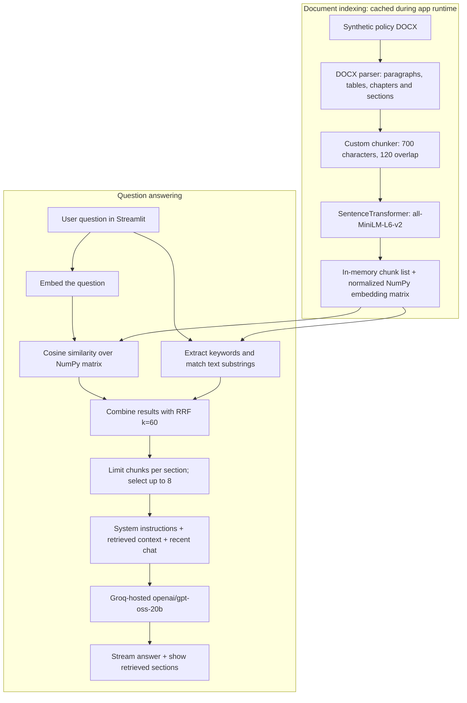

# Policy Assistant | Hybrid RAG for Structured Policy Documents

**A document-aware retrieval-augmented generation (RAG) assistant built to answer questions about a structured policy manual using semantic and keyword retrieval, Reciprocal Rank Fusion (RRF), and a hosted LLM.**

[**Try the live Streamlit demo**](https://policyassistantcloud.streamlit.app/) · [**Explore the source code**](https://github.com/bharat1271/PolicyAssistant_Cloud)

> **Portfolio-safe demo.** This public repository uses a fictional, synthetic governance policy document. It contains no real internal policy content. The original local prototype and this cloud demo use different inference and retrieval-storage backends.

## The problem

Policy manuals are harder to search than ordinary articles. They contain nested sections, rules, exceptions, metadata, and tables. A semantic-only search can retrieve text that sounds relevant but answers a different question. It can also miss some entries when a user asks for a complete list.

This project explores how **document-aware parsing and hybrid retrieval** can provide more useful context for a policy-question-answering assistant. It exposes the retrieved policy sections alongside the generated response so users can inspect its supporting material.

## What the application does

- Parses DOCX paragraphs and tables into chapter- and section-aware content.
- Splits extracted text into overlapping chunks, retaining chapter/section metadata.
- Embeds the chunks using `sentence-transformers/all-MiniLM-L6-v2` and caches a NumPy matrix in memory.
- Retrieves candidates using both cosine similarity and case-insensitive keyword matching.
- Combines candidate contributions with RRF (`k=60`) and caps how many chunks come from one section.
- Sends the selected policy context and recent conversation history to a Groq-hosted model (`openai/gpt-oss-20b`).
- Streams answers in Streamlit and lets users inspect retrieved chunks, clear chat, or export a conversation.

**Scope:** This is a demonstration of retrieval-augmented policy Q&A, not a validated production compliance or policy-decision system. Source visibility is provided through a retrieved-sections panel, not claim-by-claim verified citations.

## Architecture



**Two phases:** Documents are parsed, chunked, embedded and cached when the application builds its index. At question time, the question is embedded, both retrieval methods contribute candidates, selected chunks form the context, and the LLM generates an answer. The index is rebuilt when the application cache is rebuilt; it is not stored in a persistent vector database in this cloud version.

## Why hybrid retrieval?

Two examples from the synthetic policy illustrate the intended retrieval challenges:

| Query | Potential semantic-only limitation | Why keyword matching can help |
|---|---|---|
| “Who owns this policy?” | A chunk mentioning `Jointly-Owned-By` may be semantically similar to “owner” without identifying the document steward. | An exact owner-related term can introduce relevant metadata or document passages as candidates. |
| “What are all approved RelType values?” | A top-k similarity search may not include every relevant table passage. | Matching `RelType` can add passages containing the term, improving candidate coverage. |

These are design motivations, **not measured claims of higher accuracy**. Keyword matching does not guarantee completeness or resolve every ambiguous question. A formal retrieval evaluation is a planned improvement.

### Retrieval details

In [`retrieval.py`](retrieval.py):

1. **Semantic candidates:** normalize document and query embeddings and calculate cosine similarity with a matrix-vector dot product. Convert similarity to cosine distance (`distance = 1 - similarity`); only candidates with distance below `0.80` enter from the semantic path, up to the requested result count.
2. **Keyword candidates:** remove common stopwords from the question, retain up to four meaningful terms, then scan chunks with case-insensitive substring matching.
3. **RRF-style merge:** accumulate `1 / (60 + rank)` contributions for ranked semantic candidates. In the current simplified keyword path, each matching chunk receives a rank-1 contribution **for each matching keyword**. This is not BM25 and does not rank keyword matches by relevance; multiple keyword matches can increase the same chunk's score.
4. **Diversity:** return at most two chunks per section and up to eight chunks total.

This is a lightweight retrieval design intentionally suited to the small synthetic corpus. It is not a general benchmark against ChromaDB, FAISS, BM25, or other retrieval systems.

## Technology decisions

| Component | Public cloud demo | Why |
|---|---|---|
| UI | Streamlit | Interactive chat, streaming responses, and source inspection |
| Document parser | `python-docx` + custom logic | Preserve document structure and table text |
| Chunker | Custom Python | Control boundaries and overlap within extracted sections |
| Embeddings | `all-MiniLM-L6-v2` via SentenceTransformers | Local CPU embedding inside the cloud app process |
| Vector retrieval | NumPy | Exact cosine comparison is simple for a small corpus |
| Keyword retrieval | Case-insensitive substring scan | Lightweight exact-term candidate discovery |
| Fusion | RRF-style scoring | Combine candidate signals without adding cosine and substring scores directly |
| LLM | Groq API, `openai/gpt-oss-20b` | Hosted generation without running an Ollama server in Streamlit Cloud |

### Local prototype versus public cloud version

| | Original local implementation | This public cloud implementation |
|---|---|---|
| Inference | Qwen 2.5 14B through Ollama | `openai/gpt-oss-20b` through Groq |
| Embeddings | Ollama `nomic-embed-text` | SentenceTransformers `all-MiniLM-L6-v2` |
| Retrieval storage | Persistent ChromaDB | Cached Python chunks + NumPy matrix |
| Hosting | Local machine | Streamlit Community Cloud |
| Document | Restricted original policy (not published) | Fictional synthetic policy |

Both versions share the overall approach of structured document parsing, overlapping chunks, semantic and keyword retrieval, fusion, context construction, and grounded answer generation. **This repository contains the cloud version's source code; it is not the local Ollama codebase.**

## Project structure

```text
PolicyAssistant_Cloud/
├── app.py                        # Streamlit UI, cached indexing and Groq generation
├── config.py                     # Paths, model settings, retrieval parameters and prompt
├── docx_parser.py               # Structured paragraphs/tables and section extraction
├── chunker.py                   # Custom overlapping chunk generation
├── retrieval.py                 # Semantic retrieval, keyword matching and fusion
├── generate_synthetic_policy.py # Creates the fictional example DOCX
├── data/
│   └── MasterDataGovernancePolicy.docx
├── requirements.txt
└── README.md
```

## Run locally

**Requirements:** Python 3.10 or newer, internet access on the first embedding-model download, and a Groq API key. This command runs the **cloud-style application on your computer**, not the Ollama version.

```bash
git clone https://github.com/bharat1271/PolicyAssistant_Cloud.git
cd PolicyAssistant_Cloud
python -m venv .venv
```

Activate the virtual environment:

```bash
# Windows (PowerShell)
.venv\Scripts\Activate.ps1

# macOS/Linux
source .venv/bin/activate
```

Then install dependencies and start the app:

```bash
pip install -r requirements.txt
# Optional: regenerate the fictional example policy document
python generate_synthetic_policy.py
```

Set your key using an environment variable or an untracked `.streamlit/secrets.toml`:

```toml
# .streamlit/secrets.toml
GROQ_API_KEY = "your_groq_api_key"
```

Alternatively, set `GROQ_API_KEY` in your shell before starting the application. Finally:

```bash
streamlit run app.py
```

> **Security:** Never commit API keys or local secrets to Git. Before running this setup, add a `.gitignore` entry for `.streamlit/secrets.toml`, `.env`, `.venv/`, and `__pycache__/`. The existing README references a `.gitignore`, but it was not present in the inspected repository root.

## Deploy on Streamlit Community Cloud

1. Fork or clone the repository with the synthetic DOCX file included.
2. Create an app in [Streamlit Community Cloud](https://share.streamlit.io/) with `app.py` as its entry point.
3. Configure `GROQ_API_KEY` through the Streamlit application's **Secrets** settings.
4. Deploy and verify the app loads the sample document and can answer one of the example questions.

Do not publish your API key in the repository or place internal policy files in a public deployment.

## Sample questions

- What does EntityLevel 3 mean?
- What are all the approved RelType values?
- Who owns this policy?
- How should an entity with no verified city be handled?
- What is the process for deprecating an entity?
- What does the document say about a topic not covered in the policy?

For each response, expand **Policy sections retrieved** to examine the actual context that was passed to the model.

## Limitations and next steps

**Current limitations:**

- Substring search is not BM25 and has no keyword relevance ranking.
- Multiple matching keywords can contribute repeatedly to a chunk's fused score.
- A two-chunks-per-section cap may omit information when a complete list spans several chunks in one section.
- Follow-up questions are retrieved using the current message, without rewriting it into a standalone, context-rich question.
- Prompt instructions encourage grounding, but do not formally guarantee factual correctness or abstention.
- Retrieved sections are visible, but claims in the generated answer are not individually linked to evidence spans.
- No published, repeatable retrieval/answer-quality benchmark is included yet.

**Potential improvements:**

- Add a small evaluation set with expected sections, answer completeness, exception handling, and no-answer cases.
- Introduce optional standalone-question rewriting for follow-ups.
- Compare substring matching against BM25 and refine keyword fusion.
- Add claim-level source linking and more reliable unsupported-answer detection.
- Cache/version document embeddings when corpus size grows.
- Add error handling and configuration checks for hosted model failures.

## Data and confidentiality

The public DOCX and synthetic generator are fictional demonstration assets. They are designed to illustrate the structural problems of policy search without including actual internal policy text. The original policy document, internal index, and organization-specific data are **not part of this public repository**.

---

**Maintainer:** [Bharat Kumar](https://github.com/bharat1271) · **[Live demo](https://policyassistantcloud.streamlit.app/)**
